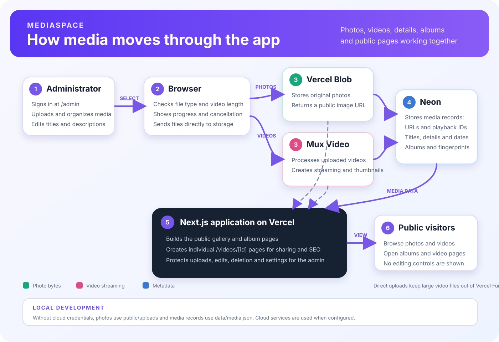
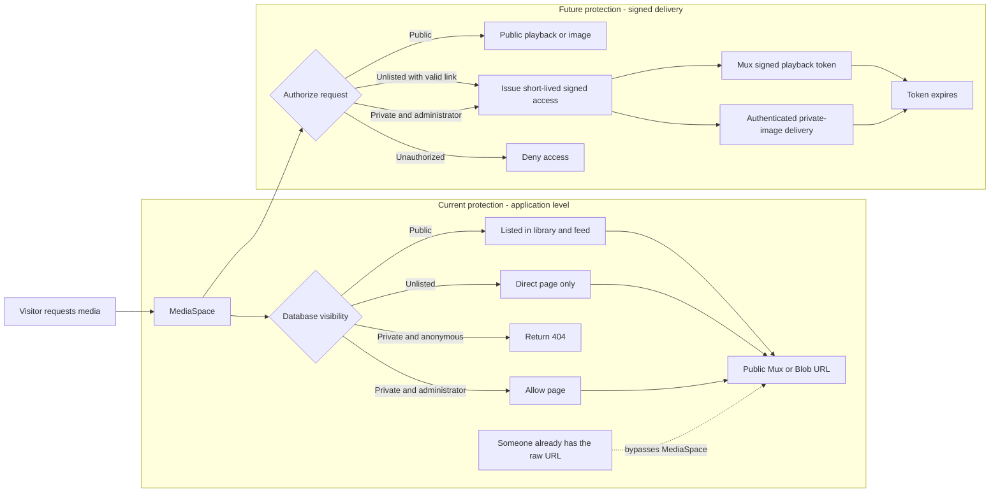

# MediaSpace

MediaSpace is a public photo and video gallery with a private administration area. Visitors can browse the gallery, albums, and individual video pages. An administrator can upload, organize, edit, scan, theme, and delete media.

## How everything works



1. The administrator opens `/admin` and signs in with the configured GitHub account or admin password.
2. The browser validates selected files and checks their metadata before upload.
3. Photos upload directly to Vercel Blob. Videos upload directly to Mux, where they are processed into streaming video and thumbnails.
4. Neon Postgres stores the media record: its URL or Mux playback ID, title, description, visibility, date, fingerprint, and album relationships.
5. The Next.js app reads those records and renders the public gallery, albums, filters, media viewer, and searchable video pages.
6. Public visitors can view media but cannot see or use the administration controls.

Direct browser uploads keep large video files out of the Vercel application function. Vercel hosts the app and its API endpoints; Mux handles video ingestion, processing, thumbnails, and playback; Vercel Blob serves photos; Neon stores structured application data.

## Planned self-hosted production architecture

MediaSpace's target production path is one public domain connected to the MediaSpace application on a private home server:

```text
example.com -> protected public gateway -> MediaSpace web app -> authorized media stream or download
```

The gateway must use an outbound encrypted tunnel or similarly isolated reverse proxy so the router, server administration, storage directories, and unrelated home services are never exposed directly. MediaSpace remains responsible for authentication and public, unlisted, and private visibility decisions. A web server designed for large transfers should serve authorized local files with HTTP range-request support; large video responses should not be proxied through a serverless function.

Local storage is intended to hold the larger video catalog without per-video cloud storage charges. Available upload bandwidth, electricity, disks, backups, hardware, and home-internet uptime remain operating constraints. The public site must display a clear temporary-unavailable state when the home server cannot be reached.

The existing cloud services will remain supported during the transition:

- Mux can host a small set of featured or higher-traffic videos within the configured capacity.
- Vercel Blob can continue storing photos.
- Neon can remain the authoritative catalog while the application moves between hosting environments.
- Vercel can remain available for preview deployments even if production moves to the home server.

Each video record will eventually identify its storage provider, such as `mux` or `home`, so MediaSpace can select the correct authorized delivery path without maintaining separate catalogs. Provider selection should be explicit or policy-driven rather than depending only on upload order.

## Local and production storage

| Content | Local fallback | Production |
| --- | --- | --- |
| Photos | `public/uploads/` | Vercel Blob |
| Videos | Local server storage, or Mux when selected | Home server as the planned primary catalog; Mux for selected videos |
| Media details | `data/media.json` | Neon Postgres |
| Albums, fingerprints, and theme | Available when the database is configured | Neon Postgres |

Local JSON records are an array of media objects. Production data uses relational database tables so media can be connected to albums and extended without duplicating records.

## Why this architecture is used professionally

MediaSpace follows patterns used by professional creator platforms and content-management systems rather than treating an uploaded file as the complete content record:

- **Creator studios:** YouTube Studio lets authorized creators edit video titles, descriptions, thumbnails, visibility, and other details after upload. MediaSpace follows the same admin-only editing model.
- **Content-management systems:** WordPress and similar systems keep the media file separate from editable information such as its title, caption, description, and page URL.
- **Search-friendly watch pages:** Google recommends giving each video a dedicated page with a unique title, description, stable thumbnail, and structured video information. MediaSpace's `/videos/[id]` pages provide the foundation for this approach.
- **Digital asset management:** Professional media libraries store large files in specialized storage while keeping searchable metadata, albums, relationships, and permissions in a database.

In MediaSpace, Mux or Vercel Blob stores the actual media, Neon stores its editable and searchable details, administrators manage those details, and Next.js turns each database record into the public gallery and individual media pages. This separation allows information to be updated without replacing the original file and keeps the same edits available across devices.

The local JSON fallback is a development convenience. A shared production database is necessary when edits must remain consistent for every visitor and administrator.

Further reading:

- [Edit video settings in YouTube Studio](https://support.google.com/youtube/answer/57404)
- [WordPress media editing](https://wordpress.org/documentation/article/edit-media/)
- [Google video SEO guidance](https://developers.google.com/search/docs/appearance/video)
- [Google VideoObject structured data](https://developers.google.com/search/docs/appearance/structured-data/video)

## Administrator and public access

- `/` is the public gallery.
- `/videos/[id]` gives a video its own shareable and search-engine-friendly page.
- `/albums` displays albums.
- `/admin` is the private entry point for administration.
- Upload, edit, delete, organize, scanning, and theme controls require an authenticated administrator session.

Hiding controls is only a user-interface improvement. The API routes also verify the administrator session before allowing changes.

## Media privacy and future signed delivery

MediaSpace supports three application-level visibility states:

- **Public:** shown in the library and feed, available through its individual page, and eligible for search indexing.
- **Unlisted:** omitted from public listings and search indexing, but available to anyone who has its direct MediaSpace link.
- **Private:** visible to the administrator; anonymous visitors cannot find it in listings and receive a `404` from its individual MediaSpace page.

When Mux signing is configured, new video uploads receive signed playback IDs and MediaSpace issues 15-minute playback, thumbnail, and storyboard tokens only through authorized application responses. When a separate private Vercel Blob store is configured, new deployed photo uploads are stored privately and streamed through an application route that checks the database visibility before delivery. Existing public Mux playback IDs and public Vercel Blob URLs remain direct delivery URLs, so someone who already possesses one of those older raw URLs may still be able to bypass the MediaSpace page.



Signed Mux playback and authenticated delivery for newly uploaded photos are implemented when their respective signing and private-storage variables are configured. Remaining rollout work:

1. Migrate existing protected photos from the legacy public Blob store carefully; existing URLs are intentionally left untouched until then.
2. Add explicit delivery-policy conversion so media intentionally made public can use normal public delivery.
3. Migrate existing protected videos carefully so current public items and links are not accidentally broken.

## Configuration

The deployed app uses these services and environment variables:

- Authentication: `NEXTAUTH_URL`, `NEXTAUTH_SECRET`, plus either `ADMIN_PASSWORD` or `GITHUB_ID`, `GITHUB_SECRET`, and `ADMIN_GITHUB_LOGIN`.
- Database: `DATABASE_URL` (the app also recognizes Vercel/Neon aliases used by existing deployments).
- Existing public photos: a connected public Vercel Blob store using `BLOB_STORE_ID`/OIDC or the legacy `BLOB_READ_WRITE_TOKEN`.
- New protected photos: a separate private Vercel Blob store connected through OIDC using `PRIVATE_BLOB_STORE_ID` and `PRIVATE_BLOB_WEBHOOK_PUBLIC_KEY`. `PRIVATE_BLOB_READ_WRITE_TOKEN` is an optional fallback for local development outside Vercel. The database must also be configured.
- Videos: `MUX_TOKEN_ID` and `MUX_TOKEN_SECRET`.
- Signed video delivery: `MUX_SIGNING_KEY_ID` and `MUX_SIGNING_PRIVATE_KEY`. Store the private key exactly as the base64 value returned by Mux; never expose it through a `NEXT_PUBLIC_` variable.
- Video capacity control: `MUX_MAX_STORED_VIDEOS` defaults to `10` for the Mux Free plan. The administrator usage panel reads the current asset count directly from Mux, and new video uploads are rejected when the configured capacity is full.

Never commit real credentials or `.env.local` to GitHub.

## Run locally

Install dependencies and start the development server:

```powershell
npm install
npm run dev
```

Open [http://localhost:3000](http://localhost:3000). Use [http://localhost:3000/admin](http://localhost:3000/admin) for administration.

## Verification

```powershell
npm run build
```

The current production deployment is managed by Vercel from the connected GitHub repository. The planned architecture moves the public production application behind a protected gateway on the home server while retaining Vercel for preview deployments if useful.

## MediaSpace backlog

- Automatically refresh the gallery after a private photo finishes processing so the new upload appears without a manual page refresh.
- Add search across titles, descriptions, dates, albums, and extracted metadata.
- Add adaptive video streaming improvements as the video library grows.
