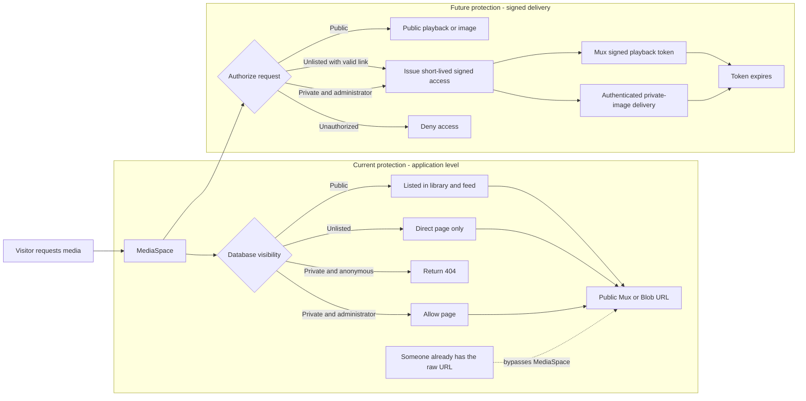

# MediaSpace

MediaSpace is a public photo and video gallery with a private administration area. Visitors can browse the gallery, albums, and individual video pages. An administrator can upload, organize, edit, scan, theme, and delete media.

## Current production architecture

Production is self-hosted on the Ubuntu server. Cloudflare sends public traffic
through its tunnel to the MediaSpace service on `127.0.0.1:3000`. The app uses
local uploads and a local JSON catalog; Vercel is connected to the GitHub repo
for pull-request preview builds, not production hosting. See
[deployment and data boundaries](docs/deployments.md) and the
[verified production state](docs/operations/current-production-state-2026-11-08.md).

```text
Visitor -> Cloudflare tunnel -> isolated MediaSpace release
Admin -> local upload API -> local media storage
                            -> shared JSON catalog and profile files
```

The administrator signs in at `/admin`. New photos and videos are written to
the configured local media directory. Media metadata is stored in
`MEDIA_DATA_DIR/media.json`; profiles and theme settings use
`profiles.json` and `site-settings.json` in that data directory. The app checks
catalog visibility before serving private local media. Public visitors receive
no management controls.

Production runs from versioned release directories managed by `npm run
deploy:prod`; `npm run rollback:prod` restores the previous validated release.
Pushing a pull-request branch still triggers Vercel preview builds through the
GitHub integration. Those previews do not change `hymecymeyseh.fun`.

## Production, development, and data ownership

| Concern | Production | Development |
| --- | --- | --- |
| App | Isolated release behind Cloudflare | Source checkout on the private development URL |
| Media catalog | `deployments/mediaspace/shared/data/media.json` | `media-dev-data/media.json` |
| Profiles and theme | `profiles.json`, `site-settings.json` in shared data | Separate development data directory |
| New local media files | `/home/mediaspacedev/media-storage` | `/home/mediaspacedev/media-dev-storage` |
| Provider mode | Local storage; database, Blob, and Mux integrations disabled | Local storage with separate data and session configuration |

The local media catalog and files are the current production source of truth.
The app’s album API requires database mode; album management is unavailable
while the production database remains disabled. Historical records can retain
external media URLs. Do not configure Neon, Vercel Blob, or Mux in production
without a reviewed provider migration and rollout plan.

## Why this architecture is used professionally

MediaSpace follows patterns used by professional creator platforms and content-management systems rather than treating an uploaded file as the complete content record:

- **Creator studios:** YouTube Studio lets authorized creators edit video titles, descriptions, thumbnails, visibility, and other details after upload. MediaSpace follows the same admin-only editing model.
- **Content-management systems:** WordPress and similar systems keep the media file separate from editable information such as its title, caption, description, and page URL.
- **Search-friendly watch pages:** Google recommends giving each video a dedicated page with a unique title, description, stable thumbnail, and structured video information. MediaSpace's `/videos/[id]` pages provide the foundation for this approach.
- **Digital asset management:** Professional media libraries store large files in specialized storage while keeping searchable metadata, albums, relationships, and permissions in a database.

MediaSpace keeps media files separate from their editable catalog records. The
current production deployment uses local files and JSON catalogs. Retained SQL,
Vercel Blob, and Mux integrations are optional code paths and are not enabled by
the current production configuration.

Further reading:

- [Edit video settings in YouTube Studio](https://support.google.com/youtube/answer/57404)
- [WordPress media editing](https://wordpress.org/documentation/article/edit-media/)
- [Google video SEO guidance](https://developers.google.com/search/docs/appearance/video)
- [Google VideoObject structured data](https://developers.google.com/search/docs/appearance/structured-data/video)

## Administrator and public access

- `/` is the public gallery.
- `/videos/[id]` gives a video its own shareable and search-engine-friendly page.
- `/albums` displays albums.
- `/admin` is the private entry point for administration.
- `/admin/experience` shows visitor journeys, link sources, gallery and playback actions, timing, and errors. It does not use session replay.
- Upload, edit, delete, organize, scanning, and theme controls require an authenticated administrator session.

Hiding controls is only a user-interface improvement. The API routes also verify the administrator session before allowing changes.

## Media privacy and future signed delivery

MediaSpace supports three application-level visibility states:

- **Public:** shown in the library and feed, available through its individual page, and eligible for search indexing.
- **Unlisted:** omitted from public listings and search indexing, but available to anyone who has its direct MediaSpace link.
- **Private:** visible to the administrator; anonymous visitors cannot find it in listings and receive a `404` from its individual MediaSpace page.

When Mux signing is configured, new video uploads receive signed playback IDs and MediaSpace issues 15-minute playback, thumbnail, and storyboard tokens only through authorized application responses. When a separate private Vercel Blob store is configured, new deployed photo uploads are stored privately and streamed through an application route that checks the database visibility before delivery. Existing public Mux playback IDs and public Vercel Blob URLs remain direct delivery URLs, so someone who already possesses one of those older raw URLs may still be able to bypass the MediaSpace page.



Signed Mux playback and authenticated delivery for newly uploaded photos are implemented when their respective signing and private-storage variables are configured. Remaining rollout work:

1. Migrate existing protected photos from the legacy public Blob store carefully; existing URLs are intentionally left untouched until then.
2. Add explicit delivery-policy conversion so media intentionally made public can use normal public delivery.
3. Migrate existing protected videos carefully so current public items and links are not accidentally broken.

## Configuration

The current production deployment uses `MEDIA_UPLOAD_PROVIDER=local`, an
absolute `MEDIA_STORAGE_ROOT`, and `MEDIA_DATA_DIR` pointing to the shared
production data directory. Authentication and tunnel credentials are kept in
server-only environment files; never commit them or `.env.local`.

The source retains optional cloud/database integrations for migration or other
deployments. They are not the current production configuration:

- Neon database mode is enabled by `DATABASE_URL`, `DATABASE_URL_DATABASE_URL`,
  or `POSTGRES_URL`.
- Public and private Vercel Blob stores use their corresponding store IDs and
  server-side credentials/OIDC settings.
- Mux video upload, webhooks, signed playback, and usage reporting require the
  Mux API, signing, and webhook settings described in the provider code.

Do not copy production credentials into development or enable a provider merely
by setting an environment variable; catalog and media migration, access policy,
and rollout need review first.

Never commit real credentials or `.env.local` to GitHub.

## Run locally

Install dependencies and start the development server:

```powershell
npm install
npm run dev
```

Open [http://localhost:3000](http://localhost:3000). Use [http://localhost:3000/admin](http://localhost:3000/admin) for administration.

## Verification

```powershell
npm run build
```

Production is self-hosted behind Cloudflare and runs from an isolated release directory. This checkout is used for development. Use `npm run deploy:prod` to build, validate, and activate a production release, or `npm run rollback:prod` to restore the previous release. See [deployment isolation and operations](docs/deployments.md) for environment, data, service, and rollback details. Running `npm run build` here does not update production.

## MediaSpace backlog

Operational incident notes: [September 23 Wi-Fi outage and prevention plan](docs/operations/2026-09-23-wifi-outage.md).

- [x] Automatically refresh the gallery after a private photo finishes processing so the new upload appears without a manual page refresh.
- Add search across titles, descriptions, dates, albums, and extracted metadata.
- Add adaptive video streaming improvements as the video library grows.

MediaSpace is managed by one administrator. There are no subscriber accounts,
paid plans, or subscription billing in the current product direction. Future
product work should improve the administrator dashboard and support importing
new photos and videos from tracked social accounts: detect a new-post notice,
match it to a MediaSpace profile, retrieve the media through a supported source,
then let the administrator review and publish it to that profile.

## Retained optional database and provider integrations

`media_storage` holds one storage record per catalog item: provider (`mux`,
`vercel-blob`, `local`, or `external`), object key, optional Mux playback ID,
and storage access mode (`public`, `signed`, `private`, or `unknown`). Access
mode describes the underlying storage; application visibility remains on `media`.
For Mux the object key is the asset ID; for Blob it is the full URL to preserve
store identity; for existing local demo uploads it is the filename.

This table applies only when database mode is configured. The runtime initializer
in `src/lib/database.ts` creates the additive schema and backfills missing storage
records on the first database request. Re-running it preserves existing storage
records. New media and storage records are saved in one SQL transaction, and
deleting catalog rows cascades to storage records. The code uses Neon’s serverless
SQL client and handwritten runtime SQL. `prisma/schema.prisma` documents the
relational shape; it is not the migration runner, and no Prisma migrate step is
part of the release workflow.

The [optional cloud-provider architecture diagram](docs/mediaspace-architecture.svg)
is a historical reference for these integrations, not the current production
deployment.

In local mode, media storage metadata is embedded in `media.json`. Older records
are inferred on read and persisted on the next catalog write. Storage metadata is
omitted from public media responses. Server code can use `getMediaStorage` or
`getLocalMediaStorage`; save functions also accept explicit storage records for
retained providers instead of requiring URL inference.

## Ubuntu local uploads and playback

Profile galleries are documented in [profile galleries and administration](docs/operations/profile-galleries.md). Each profile uses `/p/<profile-slug>` and keeps its profile record in the Ubuntu local catalog.

Development parity and the safe production-data refresh workflow are documented
in [development parity](docs/operations/development-parity.md).

For local development, the ignored `.env.local` file can select local uploads:

```dotenv
MEDIA_UPLOAD_PROVIDER=local
MEDIA_STORAGE_ROOT=/home/mediaspacedev/media-storage
```

Production settings are in `~/.config/mediaspace/production.env` and are snapshotted
into isolated releases by the deploy process. Change production configuration only
through the documented release workflow.

The storage root must be absolute and outside the repository (including its public
folder). The server creates it with mode `0700` and uploaded files with mode `0600`.
Random object names replace user filenames. New uploads stream to disk with a
server-computed SHA-256 fingerprint and a 500 MB size limit, including when the
client omits Content-Length. Failed or canceled transfers are removed. Supported
photo/video inputs include JPEG, PNG, GIF, WebP, AVIF, HEIC/HEIF, MP4, WebM, and MOV.
Server-side `ffprobe` requires a readable video track and a duration of at most five
minutes. HEIC/HEIF photos are converted to JPEG. Video uploads require a nonempty
browser-ready playback copy before catalog insertion; adaptive streaming is not
provided.

The administrator's browser requests `/api/upload-config`; local mode routes both
photos and videos to `/api/local-upload`, including when accessed through the LAN.
Historical media URLs may still reference an external provider; the current
production credentials do not enable Blob or Mux uploads. A fresh development
catalog starts without production media. New records are private by default. In
current production, media metadata and profile/theme records live in the shared
JSON data directory and media files live under `MEDIA_STORAGE_ROOT`.

JSON writes use a per-process queue, the shared `.catalog-write.lock` `flock`
protocol for cooperating app/import writers, and atomic replacement. Production
uses one app service; every maintenance writer must honor that lock. Manual edits
and older scripts are outside the lock guarantee. Back up both the catalog and
the external media directory; the separate DevOps recovery acceptance remains
open.

`/api/local-media?id=...` checks catalog visibility before opening a file. Private
media requires an administrator session; public and unlisted items allow direct
delivery, with only public items appearing in anonymous listings. Delivery supports
GET, HEAD, and single byte ranges (206/416), uses no-store caching, rejects traversal
and symlinks, and does not expose filesystem paths. Photo and video detail pages
work with local records. Deletion removes the local file and its catalog record.
Existing legacy `public/uploads/` files remain public and are not migrated.

Local playback uses byte-range support through the Ubuntu Node service. This is not
adaptive streaming or a resumable upload protocol. Production traffic reaches the
service through the Cloudflare tunnel; the current release and rollback process is
documented in [deployment operations](docs/deployments.md).

To import an existing Windows folder through SSH without browser upload limits, follow
[the Windows folder import guide](docs/operations/import-windows-folder.md).

Run storage regression checks with `npm run test:storage`, then `npm run lint`
and `npx tsc --noEmit`. The storage suite runs the application SQL against an isolated in-memory
PostgreSQL database using PGlite. It checks legacy backfill, repeat initialization,
album preservation, explicit storage records, transaction rollback, and cascading
deletion. The test adapter replaces Neon HTTP transport only; no database URL or
credentials are needed. These tests cover the retained optional SQL mode; they do
not enable Neon or database-backed albums in current production.
